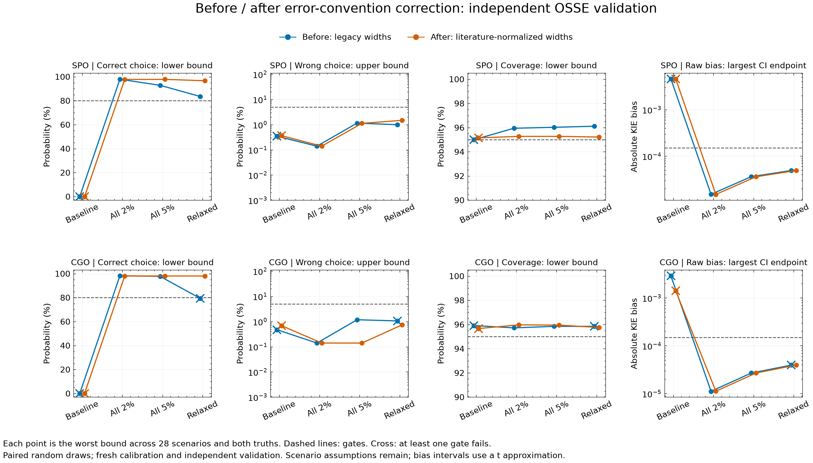
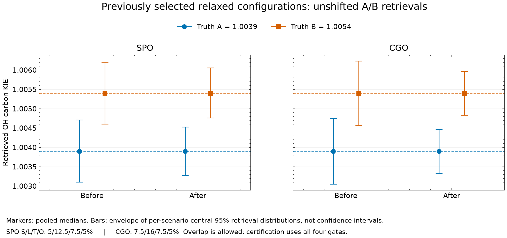

# Before/after OSSE comparison

See [parameter version and citations](PARAMETERS.md) and the [20-parameter absolute-error ledger](parameter_ledger.csv). All results are conditional; no physical model terms added.

| Site | Version | Configuration | Correct lower | Wrong upper | Coverage lower | Max bias CI magnitude | Pass |
|---|---|---|---:|---:|---:|---:|---|
| SPO | legacy | baseline | 0.000% | 0.346% | 94.996% | 0.00456496 | False |
| SPO | legacy | all_2pct | 97.919% | 0.139% | 95.947% | 1.51559e-05 | True |
| SPO | legacy | all_5pct | 92.866% | 1.147% | 96.025% | 3.62297e-05 | True |
| SPO | legacy | relaxed | 83.537% | 0.991% | 96.116% | 4.92288e-05 | True |
| SPO | literature | baseline | 0.000% | 0.363% | 95.152% | 0.00456117 | False |
| SPO | literature | all_2pct | 97.776% | 0.139% | 95.274% | 1.50775e-05 | True |
| SPO | literature | all_5pct | 97.823% | 1.121% | 95.274% | 3.60951e-05 | True |
| SPO | literature | relaxed | 96.673% | 1.474% | 95.219% | 4.9244e-05 | True |
| CGO | legacy | baseline | 0.000% | 0.474% | 95.913% | 0.00289738 | False |
| CGO | legacy | all_2pct | 98.207% | 0.139% | 95.722% | 1.11665e-05 | True |
| CGO | legacy | all_5pct | 97.764% | 1.172% | 95.845% | 2.68601e-05 | True |
| CGO | legacy | relaxed | 79.352% | 1.056% | 95.845% | 3.94467e-05 | False |
| CGO | literature | baseline | 0.000% | 0.679% | 95.666% | 0.00140737 | False |
| CGO | literature | all_2pct | 98.062% | 0.139% | 95.969% | 1.11927e-05 | True |
| CGO | literature | all_5pct | 98.062% | 0.139% | 95.947% | 2.69495e-05 | True |
| CGO | literature | relaxed | 98.050% | 0.735% | 95.755% | 3.94834e-05 | True |

Calibration estimates: 3,584,000; independent validation: 8,960,000; nonfinite inversions: 0. All validation metrics recomputed from saved NPZ and matched JSON.

Failure counts per gate are in [CSV](comparison.csv). Before and after both use new calibration and validation; old historical pass/fail labels are not reused. Between versions the reference truth population changes as well as auxiliary error widths. No claim of field feasibility, continuous admissible boundaries, structural validation, or real-observation support for A/B.
