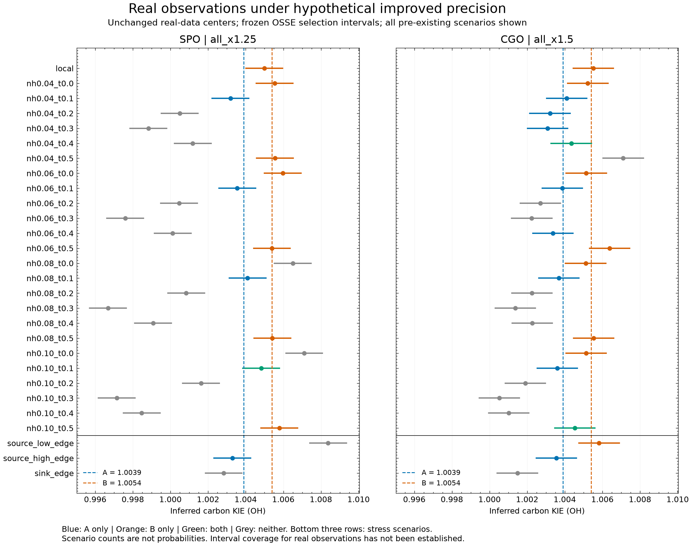

# 真实观测的条件性 A/B 分析

日期：2026-10-26。本轮执行了固定真实观测中心、假设辅助约束和观测精度改善后的条件性判别。没有修改真实数据、重新校准、根据结果挑选误差配置或增加模型复杂度。

## 预先固定的分析规则

- SPO采用此前确定的all_x1.25，S/L/T/O=.0625/.15625/.09375/.0625；CGO采用all_x1.5，倍率=.1125/.24/.1125/.075。
- 读取修正后OSSE frozen.json中的selection_halfwidth，并检查对应confirmation.json确实全情景通过。冻结宽度已包含该配置的误差校准，本次不在它上面再叠加一层Monte Carlo误差。
- 真实月序列不乘缩减系数；联合截距、趋势、年谐波拟合后，复向量扣源、取振幅比、多汇反演全部复用既有函数。
- 修正后的辅助参数中心来自literature版本；local中心的NH/热带响应权重均为零，属于默认情景，不是本站已测定值。
- 因缺乏独立本站权重估计，完整保留既有25个主情景；另列原有3个压力情景，不把它们混入主情景计数。每行的中心参数固定，不以A/B反推或调优。
- 点估计与A/B的距离不超过冻结selection_halfwidth即判相容；保留A、B、both、neither、failed。不是“取更近的一个”。不把selection区间称为真实资料95%置信区间。

## 默认local情景

| 站点 | KIE点估计 | 冻结判别半宽 | 条件性判别区间 | A=1.0039 | B=1.0054 |
|---|---:|---:|---|---|---|
| SPO | 1.004990501 | 0.000973489 | [1.004017013, 1.005963990] | 不相容 | 相容 |
| CGO | 1.005513985 | 0.001068167 | [1.004445818, 1.006582153] | 不相容 | 相容 |

在该辅助中心与假设精度下，两站均仅与B相容。SPO区间下端距A仅约0.000117，不应描述为远离边界的强证据。

## 全部主情景敏感性

| 站点 | 仅A | 仅B | 两者相容 | 两者均不相容 | 失败 |
|---|---:|---:|---:|---:|---:|
| SPO | 3 | 7 | 1 | 14 | 0 |
| CGO | 7 | 7 | 2 | 9 | 0 |

这些是25个固定网格点的分类计数，不是概率、正确率、后验支持度或情景发生频率。没有证据为不同情景赋予现实概率。SPO主情景点估计范围0.996675035–1.007106616；CGO为1.000517579–1.007104169。保留低于1及不相容输出，不裁剪成候选KIE。它们提示部分中心设定与候选假设不相容，不能单独证明两个实验室结果都错误。

三个压力情景（source_low_edge/source_high_edge/sink_edge）：SPO为neither/A/neither；CGO为B/A/neither。详细参数中心、点估计和区间见[scenarios.csv](scenarios.csv)及[results.json](results.json)。

## 核心发现与外推边界

**缩小误差宽度不等于确定辅助参数中心。** 即使固定采用通过的精度配置，当前真实观测的判别仍对源响应权重及源汇中心敏感，不能从local结果概括成“SPO和CGO共同证明B”。目前也没有跨全部主情景稳定排除A或B的结果。

原OSSE生成器在各情景中固定扣源后的氘季节信号锚点，SPO幅度约2.2384‰、CGO约2.8394‰。本轮对同一真实序列改变源中心，扣源后的氘幅度分别约为1.0113–2.2384‰、1.3891–2.8394‰（含压力情景）。因此部分情景的有效信噪比与原校准总体不同。冻结区间在这里是条件性诊断，不是已经验证可迁移到真实资料的覆盖率保证；没有为使结论通过而重新校准。

本轮采用的误差缩减尚未被现实资料证明实现，见[现实可达性核查](../osse_real_feasibility/REPORT.md)。原模型的固定KIE、温度映射、月间独立性等限制仍保留；A/B仍是固定点假设。各行的误差区间表达假定精度，不代表实测残差实际变小。

## 可以用于文章的表述

在预设的误差改善条件及默认辅助参数中心下，SPO和CGO真实观测的反演结果均仅与候选B相容。然而，该判断随允许的源响应和源汇中心设定而改变，且现有资料尚未满足相应误差条件。因此，该结果仅作为条件性探索；文章的主要依据仍是双向OSSE建立的条件性辨别能力及相应观测、辅助约束需求，不能据此对真实KIE作确定选择。

下一步应以独立资料约束辅助参数中心及误差，特别是源响应权重；并检查所用校准的信号幅度是否适用于真实场景。先确定可支持的情景，再验证相应性能，不能挑选偏向某个候选值的情景。

## 复现与验证

- 运行：PYTHONPATH=/tmp/osse-scienceplots OPENBLAS_NUM_THREADS=1 python3 experiments/KIE_sites/analysis/osse_real_conditional.py。
- 无随机抽样，seed=null；复用已冻结校准，不新增OSSE运行。
- 校验先前审计的3个输入SHA256、两站所选配置独立验证通过、冻结与确认宽度/倍率一致、56个输出、独立标量分类与原函数一致、真实数组未被修改。
- results.json记录输入、模型模块和本脚本SHA256及每行20个辅助中心；scenarios.csv可逐行复核。
- SciencePlots英文图已检查。横线为冻结选择规则区间；相同横轴便于站点对比。

[PDF](conditional_real_ab.pdf) · [SVG](conditional_real_ab.svg)
