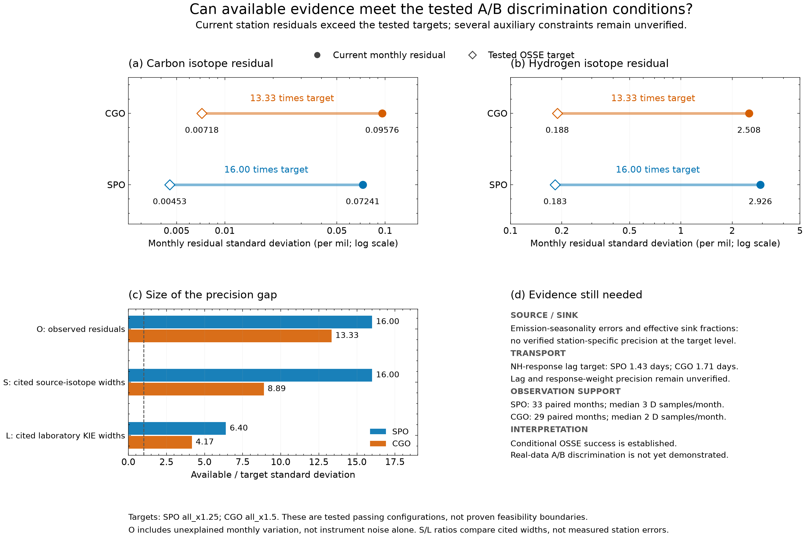

# SPO/CGO 现实资料能否满足已验证的 A/B 区分条件

核查日期：2026-10-26。结论：**当前已接入的资料未满足已通过 OSSE 配置的条件；尚无证据证明四组误差能同时达到要求。** 这是对当前资料及已核查文献的判断，不是全球技术极限，也不是对所有可能配置的不可辨别性证明。

本次沿用手稿的联合截距、趋势、年谐波拟合及现有误差定义，没有增加模型项，没有重新筛选观测或重新运行 OSSE。A/B 仍是 1.0039/1.0054 两个固定点假设。每个盒子描述该站背景筛选后的空气，不要求代表整个南半球。

## 1. 比较对象和可复算证据

以修正后同时放宽四组误差、独立验证通过的 SPO all_x1.25 和 CGO all_x1.5 为例；不拼接不同通过配置的单组最大值。它们的 O 分别为 0.0625/0.075，也是本轮有限候选集合中通过点的最大 O，不是连续参数空间的理论边界。

- 配置和已有验证结果：[configurations.csv](../osse_corrected_relaxation/configurations.csv)。
- 当前目标绝对误差：[ABSOLUTE_ERRORS.md](../osse_relaxed_constraints/ABSOLUTE_ERRORS.md)。
- 数据：[SPO](../phase1_data/site_monthly_SPO.csv)、[CGO](../phase1_data/site_monthly_CGO.csv)。
- 本次复算：[evidence.json](evidence.json)，包括输入 SHA256、样本数、残差、倍率。
- 脚本：[check.py](../../../../docs/tasks/osse-real-feasibility/check.py)。从仓库根运行 OPENBLAS_NUM_THREADS=1 python3 docs/tasks/osse-real-feasibility/check.py。无随机数，不修改科学模型。

拟合矩阵为截距、中心化时间、sin(2πt)、cos(2πt)；残差协方差为 residual.T @ residual / (n−4)，与现有 osse_manuscript_core.load_site 一致。目标数值均为投影前 1σ；比例误差以百分点明确表达。

## 2. O：当前数据直接显示未达到目标

| 站点 | 配对月数/年份 | δ13C 实际残差 σ → 目标（‰） | δD 实际残差 σ → 目标（‰） | 实际/目标 σ |
|---|---|---|---|---:|
| SPO | 33 / 2005–2009 | 0.072414 → 0.004526 | 2.925514 → 0.182845 | 16.00 |
| CGO | 29 / 2005–2009 | 0.095762 → 0.007182 | 2.507701 → 0.188078 | 13.33 |

O 是月度拟合后的剩余变化，包含观测误差及未被当前工作流解释的变化，不等于仪器精度。两种同位素共同缩放并保留协方差。不能把整项残差直接归因于输送，或再额外计入一遍输送误差。

SPO 每月碳/氘样本数中位数 10/3；CGO 为 4/2。SPO 有 9 个、CGO 有 12 个只有一个 δD 样本的月份。月度配对不自动保证同一烧瓶、同一采样时间配对。原始 NOAA value_unc 定义为 reported value 的 estimated uncertainty，未核实为统一 1σ，故未直接纳入本表。

Riddell-Young et al. (2025) Methods 的 INSTAAR δD 部分描述 2005–2009 年资料，估计测量精度约 1‰；这一单次测量指标不能直接当成月残差，也不能证明月残差达到约 0.18–0.19‰。[论文](https://doi.org/10.1073/pnas.2516543122)，[本地原文](../../../../ImportantReferences/Riddell-Young2025PNAS/Riddell-Young2025PNAS.md)。

Dasgupta et al. (2025) 给出的 WMO-GAW 网络兼容性目标为 δ13C 0.02‰、δD 1‰；它们是跨实验室兼容性目标，**不是仪器噪声下限，也不是已经实现的本站月残差精度**。恒定实验室偏移可被截距吸收，不能把整个偏移额外作为年谐波噪声；时间变化的偏移及拼接仍需检查。[原文摘要和方法](https://amt.copernicus.org/articles/18/6591/2025/)。

不能用增加样本后除以 √N 的公式直接承诺填补差距：现有数据已经是月平均，年谐波估计也已利用所有月份；残差并非已证实的独立白噪声。需要在实际采样/QC后重新估算，而非重复除以样本数。

## 3. S：有文献输入，但精度缩小与站点适用性未获验证

| 参数 | SPO 目标 σ | CGO 目标 σ | 已核查证据与判断 |
|---|---:|---:|---|
| 源 δ13C（‰） | 0.04375 | 0.07875 | Riddell-Young SI S4 湿地均值 σ=0.7‰，分别需缩小16/8.89倍；未证明本站有效源均值达到目标。 |
| SH/T 源 δD（‰） | 0.47832 | 0.86097 | Douglas Table 1 的均值95%CI ±15‰，正态换算 σ=7.653‰；需缩小16/8.89倍。 |
| NH 源 δD（‰） | 0.31888 | 0.57398 | 同上95%CI ±10‰，换算 σ=5.102‰；同样需缩小16/8.89倍。 |
| 年源强归一化（Tg/yr） | 3.125 | 5.625 | 580±50中的50是情景宽度；没有相同定义、时段、1σ口径的站点约束。 |
| SH/T/NH 六个 B/C 系数 | 各自绝对系数的1.25% | 各自绝对系数的2.25% | 本地Li数据支持中心值计算；原20%宽度是情景假设，未找到对应协方差或独立验证误差。 |

这里的源同位素文献宽度是源类别/区域均值的不确定度，不是站点有效源的后验误差，也不是直接的自然变异标准差。不能将“引用文献中心值”视为已满足收窄后的精度。六个 B/C 目标绝对值详见上面的绝对误差表。

[Douglas et al. 2021 §2.4/Table 1](https://bg.copernicus.org/articles/18/3505/2021/)，[本地原文](../../../../ImportantReferences/Douglas2021EGU/Douglas2021EGU.md)；[Riddell-Young SI](../../../../ImportantReferences/Riddell-Young2025PNAS_SI/Riddell-Young2025PNAS_SI.md)。Saunois et al. (2025) 的全球2010–2019年源强575 [553–586] Tg/yr为模型集合范围，不能直接把半宽当作1σ，也不能代替本站2005–2009有效源约束。[Global Methane Budget](https://essd.copernicus.org/articles/17/1873/2025/)。

## 4. L：实验室 KIE 与站点汇比例均有缺口

| 参数 | SPO 目标 σ | CGO 目标 σ | 对应已引用文献 σ / 证据状态 |
|---|---:|---:|---|
| OH 氘 KIE | 0.00140625 | 0.00216 | 0.009；Saueressig 2001的2σ转1σ |
| Cl 碳 KIE | 0.00015625 | 0.00024 | 0.001；Crowley 1999的2σ转1σ |
| Cl 氘 KIE | 0.00320313 | 0.00492 | 0.0205；Saueressig 1996的2σ转1σ |
| OH 比例 | 0.625个百分点 | 0.96个百分点 | 原σ=4个百分点为情景假设，尚无匹配站点估计精度 |
| Cl 比例 | 0.15625个百分点 | 0.24个百分点 | 原σ=1个百分点为情景假设，尚无匹配站点估计精度 |
| 土壤比例 | 0.3125个百分点 | 0.48个百分点 | 原σ=2个百分点为情景假设，尚无匹配站点估计精度 |

三个实验室 KIE 的目标分别比当前引用文献 σ 窄6.4倍（SPO）和4.17倍（CGO）。文献测量适用于约296–298 K；没有额外实验或有效温度映射证据时，不能因OSSE倍率缩小而声称实际知识变精确。此处未穷尽所有更新实验论文，不声称这些是全球最佳精度。

来源：[Saueressig 2001](https://doi.org/10.1029/2000JD000120)、[Crowley 1999](https://doi.org/10.1016/S0009-2614(99)00243-2)、[Saueressig 1996](https://doi.org/10.1029/96GL03292)。统一口径和此前原文核查边界见[PARAMETERS.md](../osse_literature_correction/PARAMETERS.md)。固定土壤/平流层 KIE 未传播误差，不能解释成现实中已知无误差。

## 5. T：尚无同定义的独立约束

| 参数 | SPO 目标 σ | CGO 目标 σ | 当前状态 |
|---|---:|---:|---|
| NH 源响应权重 | 0.001875 | 0.00225 | 情景参数；无独立本站估计误差证据 |
| 热带源响应权重 | 0.009375 | 0.01125 | 同上 |
| NH 响应延迟 | 0.046875月≈1.43天 | 0.05625月≈1.71天 | 尚未由资料验证到这一精度 |

权重是现有模型的源响应权重，不是空气质量份额。延迟也不是一般的气团年龄，不能用一条后向轨迹直接认证。原权重σ=.02/.1、延迟σ=.5月均为情景设定。缺乏证据不同于已经证明超标；但无法据此宣布通过现实可达性检查。

## 6. 对 A/B 结论的限制及最小下一步

- **SPO：**O实测未达目标，S/L需比现有引用宽度显著更精确，T和若干源汇宽度尚未被本站资料约束。
- **CGO：**允许误差比SPO宽，但O仍相差13.33倍；S/L/T证据缺口并未消失。CGO氘样本更稀疏，不能仅因OSSE更宽松就判定现实更容易。
- OSSE已经证明的是“在规定条件下可辨别两个固定KIE点”；当前资料尚不能把这一性能保证移植到真实观测。这里没有新执行真实A/B证据比较，也没有证明任何其他可行配置都必然失败。
- 最小下一步：先对原始本站记录核实质量标记、背景筛选、同位素时间匹配及实验室衔接；保持手稿拟合方法，复算处理后的O。不要为通过而按A/B结论调筛选阈值。若O仍远大于目标，直接报告现有资料不足，不继续任意压缩其他误差。
- 同时为S/L/T找与当前参数同定义、同时间尺度且独立于判别数据的辅助估计及其误差/协方差；找到后再代入原工作流验证，找不到则保留“情景假设”。无需新增箱子或交换时间参数。

未验证：所有最新全球仪器/实验成果的穷尽检索、尚未接入的新数据、严格同烧瓶配对与完整背景筛选审计、真实误差时间相关性、模型结构正确性、A/B实验室值自身误差传播。这些限制不影响当前月残差超出已测试目标的直接计算事实。

## 可视化

[PDF](feasibility_gap.pdf) · [SVG](feasibility_gap.svg)。上排比较当前月残差和目标；左下区分观测残差与文献参考宽度；右下列出尚缺的站点证据。
