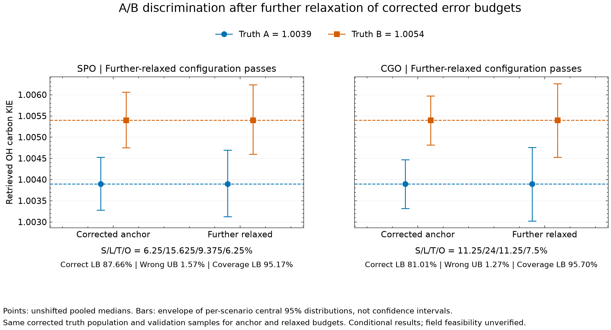
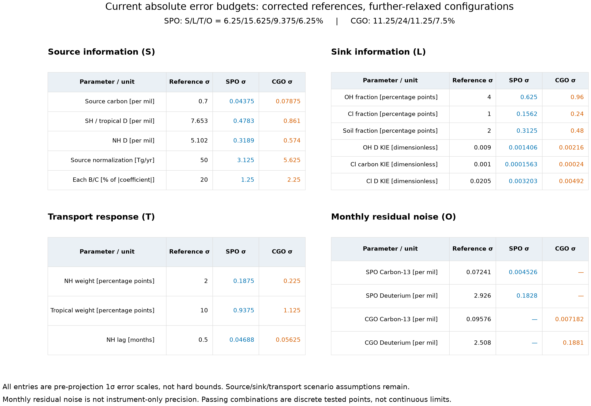

# Absolute error budgets — corrected 1σ version

Updated 2026-10-26. This table now uses the **literature-normalized** parameter version. The [legacy table](ABSOLUTE_ERRORS_LEGACY.md) and superseded figures in this directory were deleted; current figures use the corrected, further-relaxed budgets. See [corrected OSSE results](../osse_literature_correction/REPORT.md), [parameter definitions and references](../osse_literature_correction/PARAMETERS.md), and [the provenance audit](PARAMETER_PROVENANCE.md).

SPO/CGO columns below refer to the **previously selected relaxed configurations**, not the largest newly tested budgets. S/L/T/O: SPO = 5/12.5/7.5/5%; CGO = 7.5/16/7.5/5%. Percentages multiply the corrected reference standard deviation. All values are pre-projection 1σ estimation errors, not hard limits or observed site precision.

| Parameter | Unit | Nominal reference | Corrected reference σ | SPO σ | CGO σ | Width provenance |
|---|---|---:|---:|---:|---:|---|
| d13_source | ‰ | -62.1 | 0.7 | 0.035 | 0.0525 | Riddell-Young SI S4: 1σ |
| q_annual | Tg CH4/yr | 580 | 50 | 2.5 | 3.75 | **Scenario assumption** |
| B_SH | Tg CH4/month | 0.0044 | 0.00088 | 4.4e-05 | 6.6e-05 | **Scenario assumption** |
| C_SH | Tg CH4/month | 0.0776 | 0.01552 | 0.000776 | 0.001164 | **Scenario assumption** |
| B_T | Tg CH4/month | 0.2729 | 0.05458 | 0.002729 | 0.0040935 | **Scenario assumption** |
| C_T | Tg CH4/month | -0.5848 | 0.11696 | 0.005848 | 0.008772 | **Scenario assumption** |
| B_NH | Tg CH4/month | -0.1985 | 0.0397 | 0.001985 | 0.0029775 | **Scenario assumption** |
| C_NH | Tg CH4/month | -1.2436 | 0.24872 | 0.012436 | 0.018654 | **Scenario assumption** |
| dD_SH | ‰ | -301 | 7.65306122 | 0.382653061 | 0.573979592 | Douglas Table 1: 95% CI / 1.96 (normal approximation) |
| dD_T | ‰ | -301 | 7.65306122 | 0.382653061 | 0.573979592 | Douglas Table 1: 95% CI / 1.96 (normal approximation) |
| dD_NH | ‰ | -374 | 5.10204082 | 0.255102041 | 0.382653061 | Douglas Table 1: 95% CI / 1.96 (normal approximation) |
| f_oh | dimensionless | 0.84 | 0.04 | 0.005 | 0.0064 | **Scenario assumption** |
| f_cl | dimensionless | 0.035 | 0.01 | 0.00125 | 0.0016 | **Scenario assumption** |
| f_soil | dimensionless | 0.06 | 0.02 | 0.0025 | 0.0032 | **Scenario assumption** |
| alpha_d_oh | dimensionless | 1.294 | 0.009 | 0.001125 | 0.00144 | Saueressig 2001: 2σ / 2 |
| alpha_c_cl | dimensionless | 1.066 | 0.001 | 0.000125 | 0.00016 | Crowley 1999: 2σ / 2 |
| alpha_d_cl | dimensionless | 1.508 | 0.0205 | 0.0025625 | 0.00328 | Saueressig 1996: 2σ / 2 |
| w_nh | dimensionless | 0 | 0.02 | 0.0015 | 0.0015 | **Scenario assumption** |
| w_trop | dimensionless | 0 | 0.1 | 0.0075 | 0.0075 | **Scenario assumption** |
| lag_months | months | 2.8 | 0.5 | 0.0375 | 0.0375 | **Scenario assumption** |

## Meaning and limitations

- Source-category mean uncertainties and laboratory KIE uncertainties are literature-based inputs; their mapping into station auxiliary errors and the hidden-condition distribution remains a scenario assumption. Laboratory values apply near 296–298 K.
- q_annual is a global source normalization, not a station-local emission. B/C centers were reproduced from the Li dataset; their independent 20% widths remain assumptions.
- Sink fractions are dimensionless: 0.005 means 0.5 percentage points. Stratospheric fraction is the remainder; soil and stratospheric KIE constants remain fixed assumptions.
- w_nh/w_trop nominal zeros are defaults: the 28 scenarios replace them with specified weights. They represent source responses, not air-mass fractions. lag_months acts on the NH response.
- Hidden conditions are unchanged across information configurations within this corrected version. The previous literature-correction comparison changed the reference population between old and corrected versions.
- Physical projection can make realized errors correlated and asymmetric. Approximate ±1.96σ marginal ranges are neither joint bounds nor guarantees of field feasibility.

## Monthly isotope residual noise (O)

O remains 5% for both configurations above. It scales monthly residual standard deviations, not instrument-only precision. Cross-isotope covariance is retained; different months are independent in the generator.

| Site | Paired months | Reference σ δ13C (‰) | Reference σ δD (‰) | O-scaled σ δ13C (‰) | O-scaled σ δD (‰) |
|---|---:|---:|---:|---:|---:|
| SPO | 33 | 0.0724138723 | 2.92551372 | 0.00362069361 | 0.146275686 |
| CGO | 29 | 0.0957617888 | 2.50770074 | 0.00478808944 | 0.125385037 |

All scaled σ values are conditional OSSE requirements, not literature-confirmed achievable precision. Scientific forward/inverse functions are unchanged.

## Further relaxed configurations — independently validated 2026-10-26

These are additional tested passing points using the same corrected reference σ. The earlier table remains the comparison anchor. Do not combine separately passing single-group maxima.

| Site | Increase relative to anchor | S/L/T/O (%) | Worst correct lower | Worst wrong upper | Worst coverage lower |
|---|---|---|---:|---:|---:|
| SPO | All groups ×1.25 | 6.25/15.625/9.375/6.25 | 87.661% | 1.573% | 95.174% |
| CGO | All groups ×1.5 | 11.25/24/11.25/7.5 | 81.013% | 1.274% | 95.699% |

Absolute 1σ values for these additional configurations:

| Parameter | Unit | SPO further-relaxed σ | CGO further-relaxed σ |
|---|---|---:|---:|
| d13_source | ‰ | 0.04375 | 0.07875 |
| q_annual | Tg CH4/yr | 3.125 | 5.625 |
| B_SH | Tg CH4/month | 5.5e-05 | 9.9e-05 |
| C_SH | Tg CH4/month | 0.00097 | 0.001746 |
| B_T | Tg CH4/month | 0.00341125 | 0.00614025 |
| C_T | Tg CH4/month | 0.00731 | 0.013158 |
| B_NH | Tg CH4/month | 0.00248125 | 0.00446625 |
| C_NH | Tg CH4/month | 0.015545 | 0.027981 |
| dD_SH | ‰ | 0.478316327 | 0.860969388 |
| dD_T | ‰ | 0.478316327 | 0.860969388 |
| dD_NH | ‰ | 0.318877551 | 0.573979592 |
| f_oh | dimensionless | 0.00625 | 0.0096 |
| f_cl | dimensionless | 0.0015625 | 0.0024 |
| f_soil | dimensionless | 0.003125 | 0.0048 |
| alpha_d_oh | dimensionless | 0.00140625 | 0.00216 |
| alpha_c_cl | dimensionless | 0.00015625 | 0.00024 |
| alpha_d_cl | dimensionless | 0.003203125 | 0.00492 |
| w_nh | dimensionless | 0.001875 | 0.00225 |
| w_trop | dimensionless | 0.009375 | 0.01125 |
| lag_months | months | 0.046875 | 0.05625 |
- SPO monthly residual σ (δ13C / δD): 0.00452586702 / 0.182844608 ‰.
- CGO monthly residual σ (δ13C / δD): 0.00718213416 / 0.188077555 ‰.

All four gates pass in all 28 scenarios and both truth directions. CGO correct-choice lower bound is close to 80%; these points are not stable continuous maxima. The fresh run tested 16 configurations per site: SPO9/16 and CGO15/16 passed including controls. Some SPO failures are coverage-only; finite-sample certification can be nonmonotonic. Both sites fail when only O is doubled to10%. See [full confirmation report](../osse_corrected_relaxation/REPORT.md).

## Current figures

